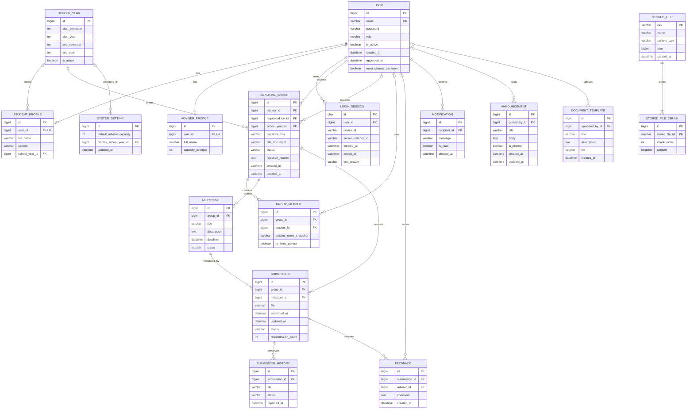

# Capstone Monitor ERD

This diagram documents the application's Django data models. The database is
MySQL (hosted on Aiven in production). The current model and migration files in
`backend/` are the source of truth for the schema.

## Notes

- `USER` is the custom Django user table. It inherits standard authentication
  fields from Django's `AbstractUser`; this diagram shows the fields most
  relevant to the application and omits Django's permission and group join
  tables.
- A user has one role (`admin`, `adviser`, or `student`). `STUDENT_PROFILE` and
  `ADVISER_PROFILE` hold role-specific details; admin accounts do not need a
  profile row.
- A `GROUP_MEMBER` may have no `student_id`: listed partners can be represented
  by `student_name_snapshot` without an account. The snapshot also preserves a
  member's name if their user account is deleted.
- A group can have one submission per milestone. Resubmission updates that
  submission and saves the previous file and status in `SUBMISSION_HISTORY`.
- File fields store a key. `STORED_FILE` and `STORED_FILE_CHUNK` hold the file
  metadata and bytes in MySQL, in one-megabyte chunks. The key links these rows
  at the storage layer; domain tables do not have separate foreign keys to
  `STORED_FILE`.
- `REPORTS` has no model of its own; reports are generated from existing data.
